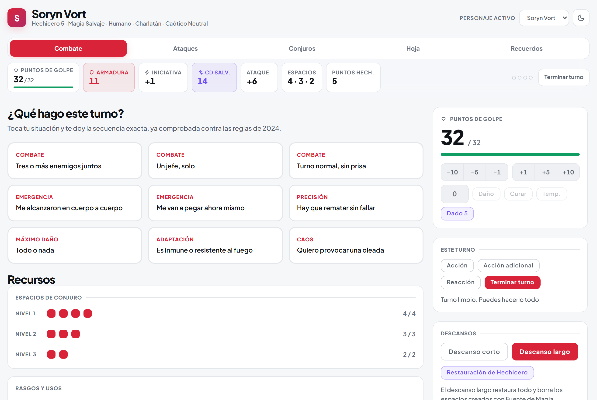
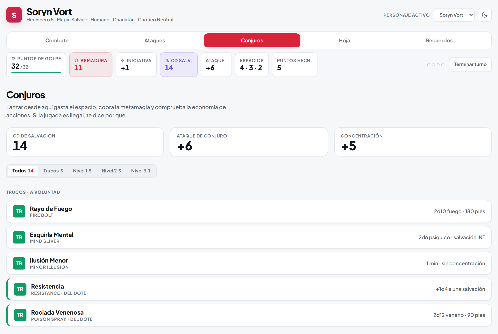
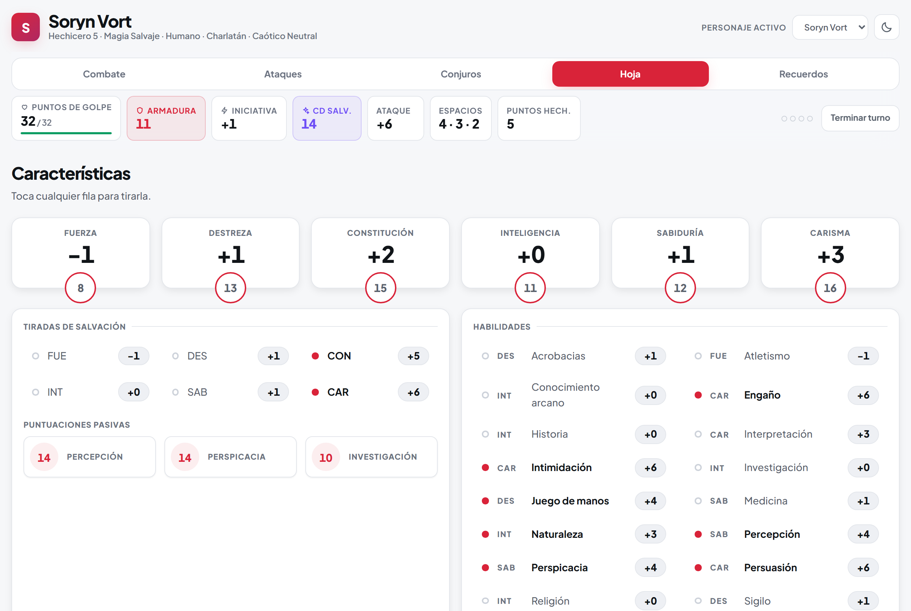
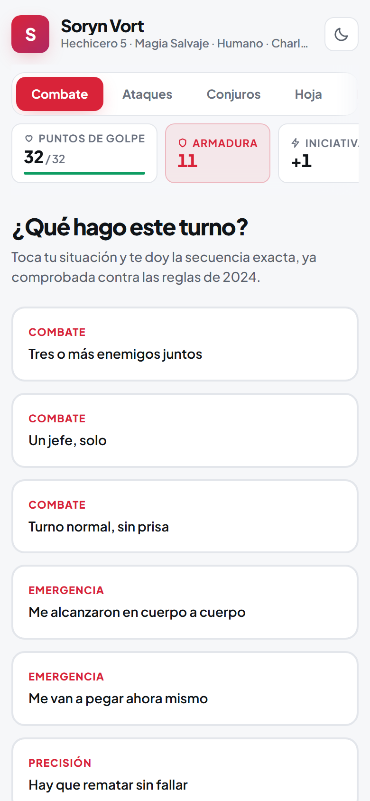
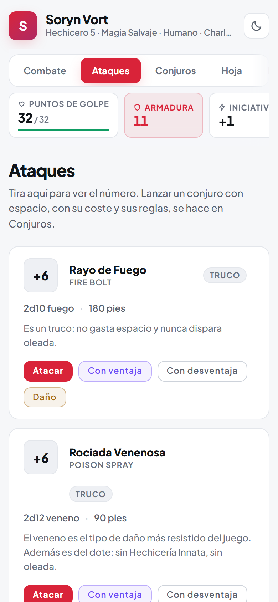

<div align="center">

# Consola de Mesa · D&D 2024

**La hoja de personaje que juega contigo.**<br />
Tira ataques a un toque, lanza conjuros que se cobran solos y deja que la app te avise
cuando una jugada rompe las reglas, antes de que lo haga el DM.

[**Abrir la demo →**](https://littlepitza.github.io/dnd-companion/)

[](https://github.com/LittlePitza/dnd-companion/actions/workflows/ci.yml)


<br />

<picture>
  <source media="(prefers-color-scheme: dark)" srcset="docs/screenshots/combate-dark.png" />
  
</picture>

</div>

## Por qué existe

En plena partida nadie quiere hojear el manual para saber si puede lanzar dos conjuros en el
mismo turno, ni llevar la cuenta de los espacios con lápiz y goma. Esta consola lleva la
cuenta por ti y conoce las reglas de 2024, así que el turno se resuelve en segundos.

Todo vive en tu navegador: sin cuentas y sin servidor. Tus datos no salen de tu dispositivo.

## Qué hay dentro

- **Combate**: elige tu situación («me alcanzaron cuerpo a cuerpo», «un jefe, solo») y
  recibe la secuencia exacta del turno. Aquí también llevas los puntos de golpe, los recursos,
  los descansos y la oleada de magia salvaje.
- **Ataques**: armas y conjuros de ataque con el bonificador ya calculado. Tira normal, con
  ventaja o con desventaja.
- **Conjuros**: al lanzar se gasta el espacio, se cobra la metamagia y, si la jugada es
  ilegal, te dice por qué.
- **Hoja**: características, salvaciones y habilidades. Toca cualquier fila para tirarla.
- **Recuerdos**: la bitácora de campaña, con búsqueda, categorías y respaldo en JSON.

<table>
  <tr>
    <td width="50%">
      <picture>
        <source media="(prefers-color-scheme: dark)" srcset="docs/screenshots/conjuros-dark.png" />
        
      </picture>
    </td>
    <td width="50%">
      <picture>
        <source media="(prefers-color-scheme: dark)" srcset="docs/screenshots/hoja-dark.png" />
        
      </picture>
    </td>
  </tr>
</table>

## Las reglas que vigila

Estas son las que más se olvidan en la mesa:

- Un solo espacio de conjuro por turno.
- **Conjuro Acelerado** no puede ir antes ni después de un conjuro de nivel 1 o más.
- Una sola metamagia por conjuro, y solo las que conoces.
- **Conjuro Transmutado** no admite el daño de fuerza (adiós, Proyectil Mágico).
- Acción, acción adicional y reacción se gastan una vez por turno.
- **Francotirador de Conjuros** solo extiende el alcance de los conjuros con tirada de ataque.
- **Oleada de Magia Salvaje** solo tras gastar un espacio en un conjuro de hechicero, una vez
  por turno. **Mareas de Caos** la hace automática.
- Los espacios creados con **Fuente de Magia** desaparecen en el descanso largo.

## Pensada para el teléfono

<table>
  <tr>
    <td align="center">
      <picture>
        <source media="(prefers-color-scheme: dark)" srcset="docs/screenshots/movil-combate-dark.png" />
        
      </picture>
    </td>
    <td align="center">
      <picture>
        <source media="(prefers-color-scheme: dark)" srcset="docs/screenshots/movil-ataques-dark.png" />
        
      </picture>
    </td>
    <td valign="middle">
      Se usa con una mano y durante horas, muchas veces con poca luz. Por eso trae tema oscuro
      y claro (sigue al sistema y recuerda tu elección), botones grandes y navegación por
      flechas entre pestañas.<br /><br />
      Si el navegador no deja guardar datos, la app sigue funcionando en memoria y te avisa.
    </td>
  </tr>
</table>

## Tu propio personaje

Viene con **Soryn Vort**, hechicero de Magia Salvaje de nivel 5. Para jugar con otro personaje:

1. Copia `src/data/characters/sorynVort.ts` y cambia los valores.
2. Regístralo en `src/data/characters/index.ts`.

Aparece en el selector de la cabecera. No hay que tocar ningún componente ni ninguna regla.

## Desarrollo

```bash
npm install
npm run dev       # servidor local
npm test          # 194 pruebas
npm run verify    # lint + pruebas + build, lo mismo que corre en CI
```

Cada push a `main` se publica solo en GitHub Pages.

<details>
<summary><strong>Cómo está hecha</strong></summary>

<br />

React 19, TypeScript estricto (`strict` y `noUncheckedIndexedAccess`), Zustand y Vite.
Pruebas con Vitest y Testing Library, lint con oxlint.

```
src/
├── domain/          Reglas puras: sin React, sin navegador, sin E/S
│   ├── dice/        Notación de dados; la aleatoriedad entra por un puerto inyectable
│   ├── character/   Tipos y estadísticas derivadas
│   ├── turn/        Motor de economía de acciones
│   ├── wildmagic/   Oleada y Mareas de Caos
│   └── session/     Estado de la partida: PG, recursos, lanzamientos, descansos
├── data/            Personajes como datos
├── content/         Todo el texto en español, separado de la lógica
├── infrastructure/  Almacenamiento con degradación elegante
├── store/           Zustand: envuelve el dominio, no reimplementa reglas
├── features/        UI por pestaña
└── shared/          Componentes y hooks reutilizables
```

- **Las reglas son funciones puras.** Las pruebas fijan los dados, así que cada regla es
  determinista. Las de `derived.test.ts` comparan los números con la hoja oficial del
  personaje.
- **Nada se guarda precalculado.** La CA, la CD de salvación y los bonificadores se derivan en
  cada render. Activar Armadura de Mago recalcula toda la hoja.
- **Código en inglés, mesa en español.** El motor devuelve códigos estables
  (`ONE_SLOT_PER_TURN`) y `src/content/ruleMessages.ts` los traduce a texto.
- **Respaldos versionados.** Al importar se valida cada recuerdo antes de reemplazar nada.

</details>

---

<sub>Proyecto de fans, sin relación con Wizards of the Coast. Las reglas siguen el
<em>Player's Handbook</em> (2024), pero la app no reproduce su texto: para la tabla de Oleada
de Magia Salvaje te da el resultado del d100 y la página donde buscarlo.</sub>
