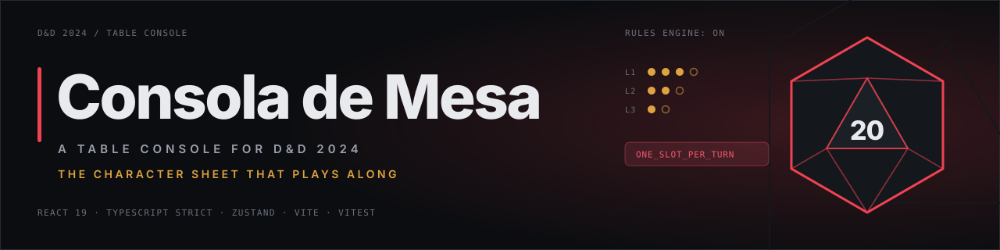
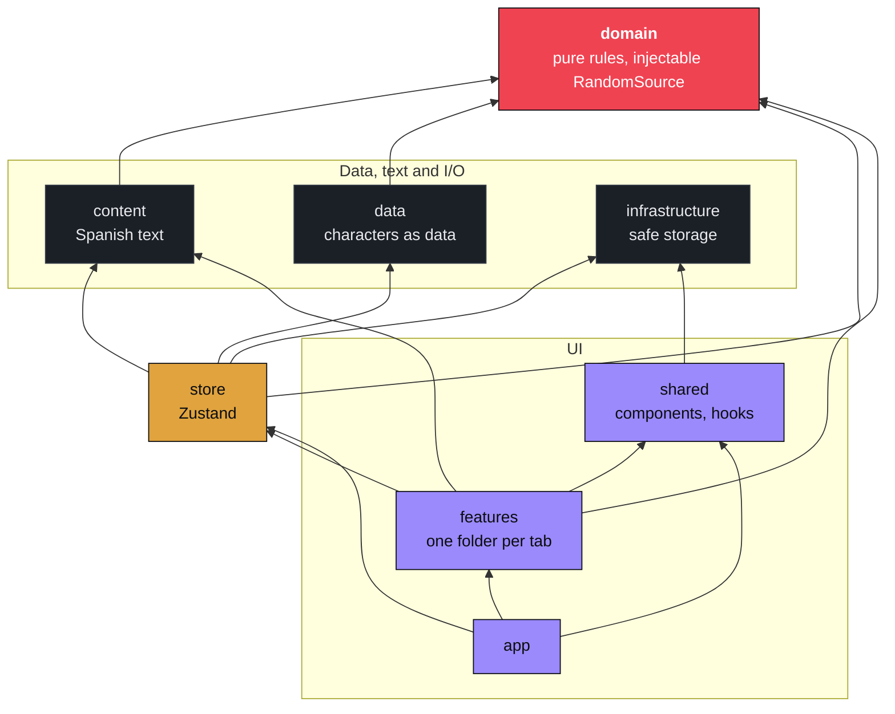

<p align="center">
  
</p>

<p align="center">
  <a href="https://github.com/LittlePitza/dnd-companion/actions/workflows/ci.yml"></a>
  <a href="https://github.com/LittlePitza/dnd-companion/actions/workflows/deploy.yml"></a>
  
  
  
  
</p>

<p align="center">
  A character sheet that plays along with you at the table.<br>
  Rolls attacks in one tap, charges spell slots on its own and flags a play that breaks the 2024 rules.
</p>

<p align="center">
  <a href="https://littlepitza.github.io/dnd-companion/">Live demo</a> &nbsp; / &nbsp;
  <a href="#architecture">Architecture</a> &nbsp; / &nbsp;
  <a href="#rules-it-enforces">Rules</a> &nbsp; / &nbsp;
  <a href="#adding-a-character">Add a character</a> &nbsp; / &nbsp;
  <a href="#local-development">Development</a>
</p>

<br>

## The idea

In the middle of a session nobody wants to leaf through the rulebook to find out whether two
spells fit in one turn, or keep a tally of spell slots in pencil. The console keeps the
count and knows the 2024 rules, so a turn resolves in seconds and a mistake is caught before
the DM has to catch it.

Everything runs in the browser. There are no accounts and no server, and nothing leaves the
device. The rules engine is generic: each character is a data file, and the app ships seeded
with Soryn Vort, a level 5 Wild Magic sorcerer.

> [!NOTE]
> The interface is in Spanish, because it is read at the table by a Spanish-speaking group.
> Code, comments and this documentation are in English. The two meet in
> [`src/content/ruleMessages.ts`](src/content/ruleMessages.ts), described under
> [Design decisions](#design-decisions).

<p align="center">
  <picture>
    <source media="(prefers-color-scheme: dark)" srcset="docs/screenshots/combate-dark.png">
    
  </picture>
</p>

<br>

## What is inside

<table>
  <tr>
    <td width="33%" valign="top">
      <strong>Combate</strong><br>
      Pick your situation, such as being caught in melee or facing a boss alone, and get the exact sequence for the turn. Hit points, resources, rests and the Wild Magic surge live here too.
    </td>
    <td width="33%" valign="top">
      <strong>Ataques</strong><br>
      Weapons and attack spells with the bonus already worked out. Roll normally, with advantage or with disadvantage, and every roll lands in the log.
    </td>
    <td width="33%" valign="top">
      <strong>Conjuros</strong><br>
      Casting spends the slot, charges the metamagic and, when the play is illegal, says why. A spell can be refused for several reasons at once, and all of them are listed.
    </td>
  </tr>
  <tr>
    <td width="33%" valign="top">
      <strong>Hoja</strong><br>
      Ability scores, saving throws and skills. Tap any row to roll it. Armor class, spell save DC and every bonus are derived on each render, so toggling Mage Armor recomputes the sheet.
    </td>
    <td width="33%" valign="top">
      <strong>Recuerdos</strong><br>
      The campaign journal, with search, categories and a JSON backup. It is the only part of the app that holds irreplaceable data, so export and import are validated end to end.
    </td>
    <td width="33%" valign="top">
      <strong>Built for a phone</strong><br>
      One-handed use for hours, often in a dim room: dark and light themes that follow the system and remember your choice, large controls and arrow-key navigation between tabs.
    </td>
  </tr>
</table>

<table>
  <tr>
    <td width="50%">
      <picture>
        <source media="(prefers-color-scheme: dark)" srcset="docs/screenshots/conjuros-dark.png">
        
      </picture>
    </td>
    <td width="50%">
      <picture>
        <source media="(prefers-color-scheme: dark)" srcset="docs/screenshots/hoja-dark.png">
        
      </picture>
    </td>
  </tr>
</table>

<p align="center">
  <picture>
    <source media="(prefers-color-scheme: dark)" srcset="docs/screenshots/movil-combate-dark.png">
    
  </picture>
  &nbsp;&nbsp;&nbsp;
  <picture>
    <source media="(prefers-color-scheme: dark)" srcset="docs/screenshots/movil-ataques-dark.png">
    
  </picture>
</p>

<br>

## Rules it enforces

These are the ones most often forgotten at the table. Each violation is a stable code
returned by the engine; the Spanish explanation shown to the player is looked up from it.

| Rule                                                                                                                                           | Engine code                                                                                       |
| ---------------------------------------------------------------------------------------------------------------------------------------------- | ------------------------------------------------------------------------------------------------- |
| Only one spell slot may be spent per turn                                                                                                      | `ONE_SLOT_PER_TURN`                                                                               |
| **Quickened Spell** cannot be used after a level 1+ spell, and no level 1+ spell may follow it in the same turn                                | `QUICKEN_AFTER_LEVELED_SPELL`, `QUICKENED_LOCKOUT`                                                |
| **Quickened Spell** only applies to spells cast with an action                                                                                 | `QUICKEN_REQUIRES_ACTION_SPELL`                                                                   |
| One metamagic option per spell, and only options the character knows                                                                           | `ONE_METAMAGIC_PER_SPELL`, `METAMAGIC_NOT_KNOWN`                                                  |
| **Transmuted Spell** only converts acid, cold, fire, lightning, poison and thunder damage, so force damage (Magic Missile) is refused          | `DAMAGE_TYPE_NOT_TRANSMUTABLE`                                                                    |
| Action, bonus action and reaction are each spent once per turn                                                                                 | `ACTION_ALREADY_USED`, `BONUS_ACTION_ALREADY_USED`, `REACTION_ALREADY_USED`                       |
| A spell needs a slot of at least its level, the sorcery points for its metamagic and any free casting it relies on                             | `NO_SLOTS_REMAINING`, `SLOT_LEVEL_TOO_LOW`, `NOT_ENOUGH_SORCERY_POINTS`, `NO_FREE_USES_REMAINING` |
| **Spell Sniper** extends range only for spells that use an attack roll                                                                         | per-spell note in the character data                                                              |
| **Wild Magic Surge** is checked only after a slot is spent on a sorcerer spell, once per turn. **Tides of Chaos** makes the next one automatic | `src/domain/wildmagic/surge.ts`                                                                   |
| Slots created with **Font of Magic** disappear on a long rest                                                                                  | `src/domain/session/rest.ts`                                                                      |

> [!NOTE]
> The app does not reproduce rulebook text. For the Wild Magic Surge table it gives you the
> d100 result and the page of the Player's Handbook where the entry is.

<br>

## Architecture

Dependencies point inward. The domain at the centre knows nothing about React, the browser
or any other folder; everything else may depend on it, never the reverse.



The domain is plain TypeScript: dice, derived statistics, the action economy, Wild Magic
and the session state (hit points, resources, casts, rests). The store wraps it with Zustand
and persistence rather than reimplementing rules. Features render one tab each and read
derived values through selectors.

```text
src/
├── domain/          Pure rules: no React, no browser, no I/O
│   ├── dice/          Dice notation; randomness enters through an injectable port
│   ├── character/     Types and derived statistics
│   ├── turn/          Action-economy engine and rule violation codes
│   ├── wildmagic/     Surge check and Tides of Chaos
│   └── session/       Play state: hit points, resources, casts, rests
├── data/            Characters as data (sorynVort.ts) and the roster
├── content/         All Spanish text, kept apart from the logic
├── infrastructure/  Storage that degrades gracefully
├── store/           Zustand: wraps the domain, never reimplements rules
├── features/        UI per tab: combat, attacks, spells, sheet, memories, vitals, log
├── shared/          Reusable components and hooks
├── styles/          Design tokens, global and motion CSS
└── app/             Shell: tab strip, character picker, theme toggle
```

<br>

## Design decisions

- **Rules are pure functions.** Randomness is an explicit port, `RandomSource`; production
  injects a Web Crypto source with rejection sampling so no die face is biased, and tests
  inject a scripted sequence. Every rule is therefore deterministic. The cases in
  `derived.test.ts` compare the numbers with the character's official sheet.
- **Nothing derived is stored.** Armor class, spell save DC and bonuses are recomputed on
  each render from the character and the active effects. A stored copy would be one more
  value to keep in sync, and Mage Armor would have to remember to update it.
- **English code, Spanish table.** The engine returns stable codes such as
  `ONE_SLOT_PER_TURN`, and `src/content/ruleMessages.ts` is the only place that turns a
  code into text. Rewording a message never touches a rule, and a new language would be one
  new file.
- **Graceful storage degradation.** If the browser denies `localStorage` (private windows,
  blocked site data, embedded contexts) the app keeps working from memory and tells the
  player that nothing will persist. Availability is probed with a real write, since some
  browsers expose the object and throw on access.
- **A versioned backup envelope.** The memories export is the campaign's only real backup,
  so it carries a format name and a version. Import validates the envelope and every field of
  every memory before it replaces anything, and a file from a future format is refused rather
  than half-read.
- **No `dangerouslySetInnerHTML`.** The only markup the character data needs is `**emphasis**`.
  `RichText` splits it into React elements and renders everything else as plain text, so no
  string is ever handed to the DOM as markup.

<br>

## Stack

| Layer           | Technology                                           | Role                                                               |
| --------------- | ---------------------------------------------------- | ------------------------------------------------------------------ |
| UI              | React 19, CSS Modules                                | Rendering, with design tokens in `src/styles/tokens.css`           |
| Language        | TypeScript, `strict` plus `noUncheckedIndexedAccess` | Typed domain model and character data                              |
| State           | Zustand 5 with `persist`                             | Campaign and memories stores, saved through the safe storage layer |
| Build           | Vite 8                                               | Dev server and production bundle                                   |
| Tests           | Vitest, Testing Library, jsdom                       | Domain rules, stores, backup format and the app shell              |
| Lint and format | oxlint, Prettier                                     | Static analysis and formatting                                     |
| Hosting         | GitHub Pages                                         | Static deployment through GitHub Actions                           |

<br>

## Local development

Requires Node 22, the version CI runs, and npm.

```bash
npm install
npm run dev
```

| Command                                   | Purpose                                   |
| ----------------------------------------- | ----------------------------------------- |
| `npm run dev`                             | Start the Vite dev server                 |
| `npm test`                                | Run the 194 tests once                    |
| `npm run test:watch`                      | Run the tests in watch mode               |
| `npm run test:coverage`                   | Coverage for `src/domain` and `src/store` |
| `npm run lint`                            | oxlint                                    |
| `npm run typecheck`                       | `tsc -b`                                  |
| `npm run format` / `npm run format:check` | Write or check Prettier formatting        |
| `npm run build`                           | Typecheck and build for production        |
| `npm run verify`                          | Lint, test and build, the gate CI runs    |

### Adding a character

A character is a data file, so no component and no rule has to change.

1. Copy `src/data/characters/sorynVort.ts` and change the values.
2. Add it to `CHARACTER_ROSTER` in `src/data/characters/index.ts`.

It appears in the character picker in the header. The situations listed under Combate, the
spells and the rules notes all come from that file.

### Deployment

Every push to `main` is built and published to
[littlepitza.github.io/dnd-companion](https://littlepitza.github.io/dnd-companion/) by
[`deploy.yml`](.github/workflows/deploy.yml). Pages serves a project site from
`/dnd-companion/`, so the workflow builds with `VITE_BASE_PATH` set to that sub-path. The
active tab lives in the URL hash rather than a router, and the workflow also copies
`index.html` to `404.html` so a hand-edited path does not dead-end.

[`ci.yml`](.github/workflows/ci.yml) runs lint, typecheck, tests and build on every push and
pull request to `main`.

<br>

## Documentation

| Document                                                               | For                                                          |
| ---------------------------------------------------------------------- | ------------------------------------------------------------ |
| [`docs/Soryn_Vort_Guia_de_Juego.md`](docs/Soryn_Vort_Guia_de_Juego.md) | Play guide for the seeded character, in Spanish              |
| [`docs/Soryn_Vort_Conjuros.md`](docs/Soryn_Vort_Conjuros.md)           | Spell reference for the seeded character, in Spanish         |
| [`docs/Soryn_Vort_Hoja_ES.md`](docs/Soryn_Vort_Hoja_ES.md)             | Transcription guide for the official Spanish character sheet |
| [`docs/legacy-prototype.html`](docs/legacy-prototype.html)             | The single-file prototype that preceded the app              |

<br>

<p align="center">
  <sub>A fan-made project, not affiliated with Wizards of the Coast. The rules follow the 2024 Player's Handbook, but the app does not reproduce its text.</sub>
</p>
